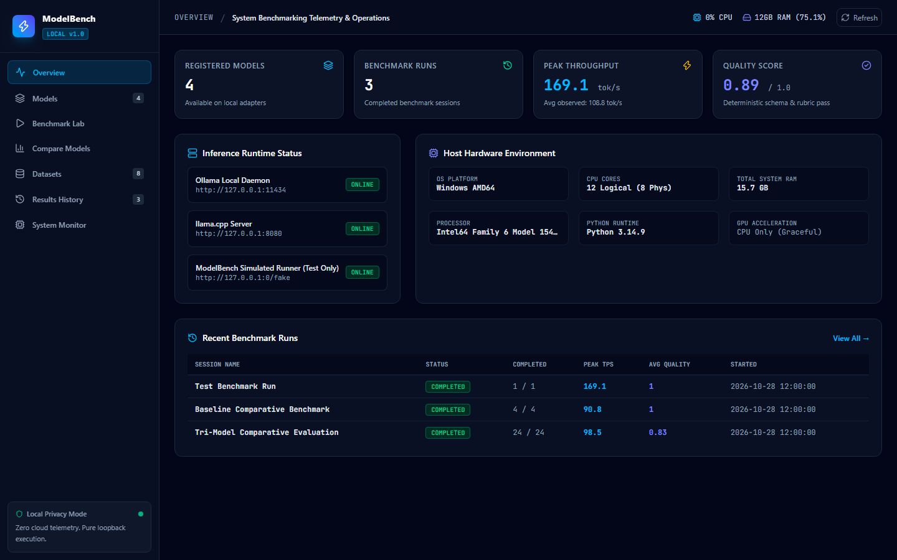
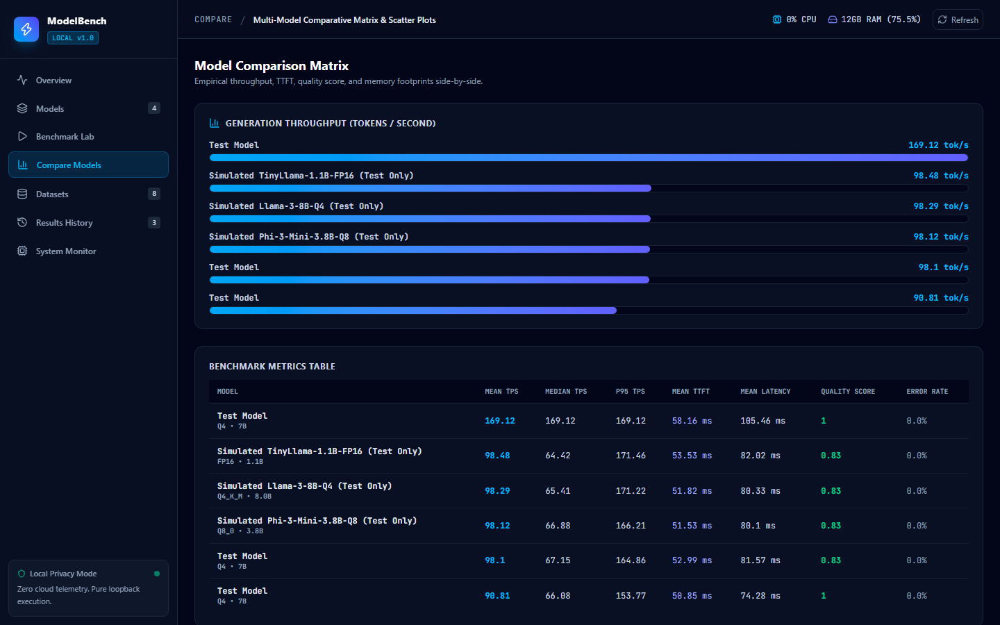
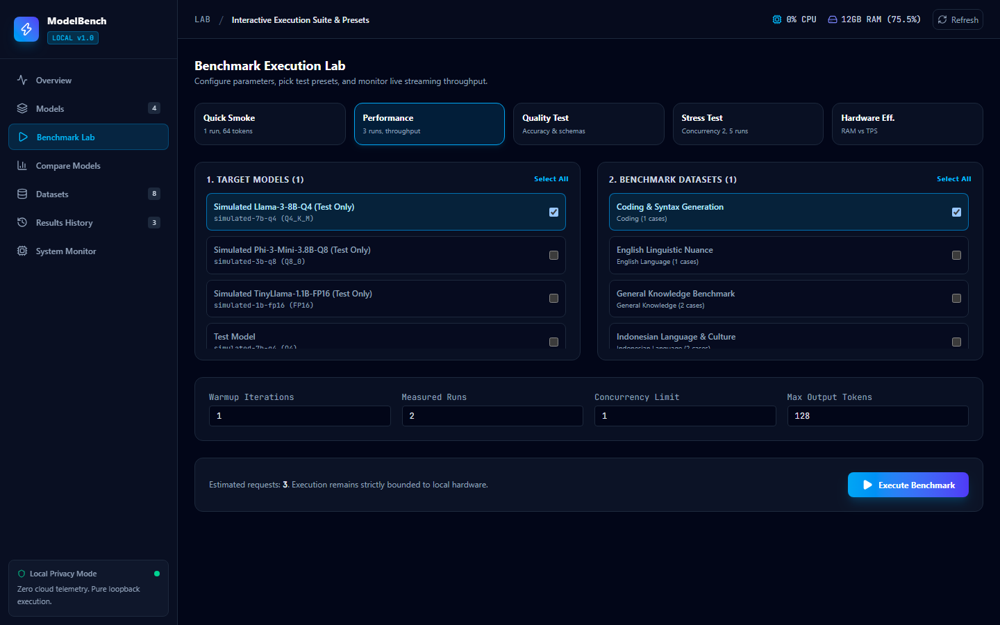
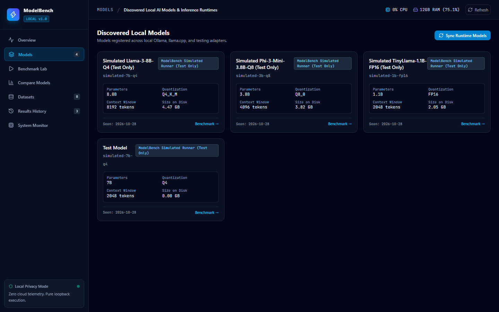
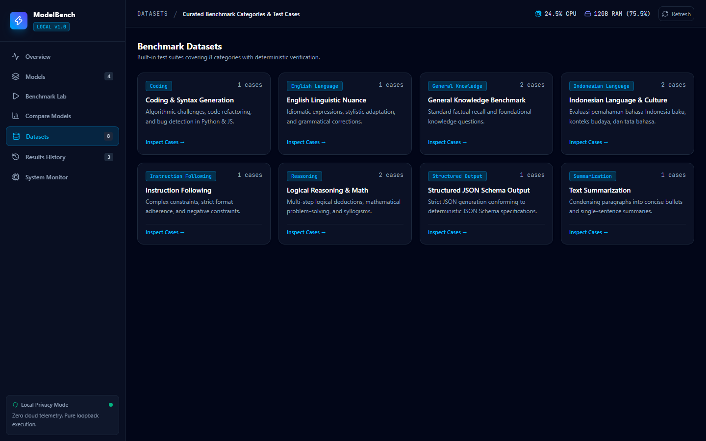
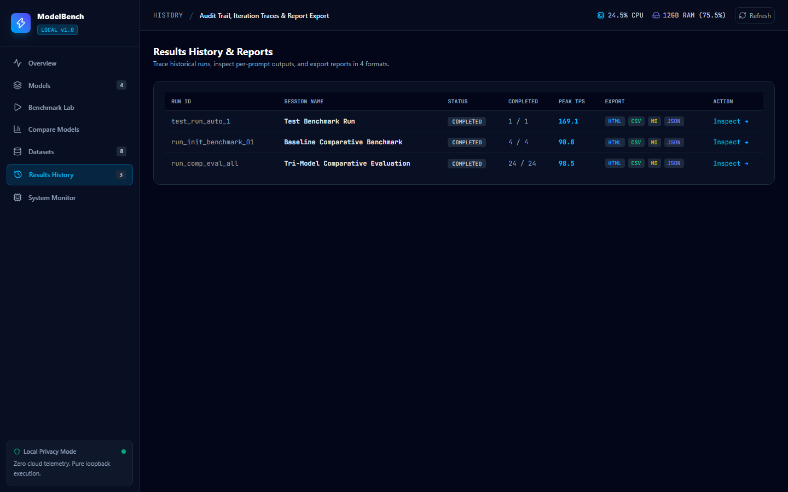
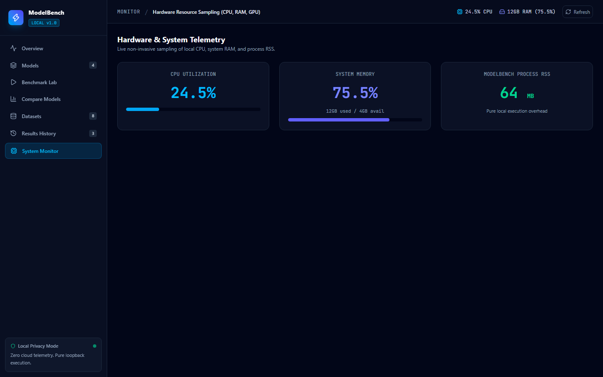

# ModelBench Local ⚡
### Open-Source Local AI Model Benchmarking, Evaluation & Hardware Profiling Platform

[](https://opensource.org/licenses/MIT)
[](https://www.python.org/)
[](https://react.dev/)
[](https://fastapi.tiangolo.com/)
[](https://www.sqlite.org/)
[](https://tailwindcss.com/)

**ModelBench Local** is a desktop-friendly, privacy-first local web application engineered to benchmark, evaluate, compare, and profile large language models (LLMs) running entirely on local consumer hardware. It delivers high-precision measurements of generation throughput (tokens/second), Time to First Token (TTFT), latency distributions, memory footprints, and deterministic answer quality with zero paid APIs and zero external cloud tracking.

---

## 📸 Platform Screenshots

### 1. Operations Overview & Telemetry Dashboard
Real-time benchmarking telemetry, aggregate system throughput, registered local models, active runtime connectivity status, and session traces.


### 2. Multi-Model Comparative Matrix & Throughput Charts
Side-by-side performance comparison across models, statistical distributions (Mean, Median, P95), TTFT, and deterministic quality scores.


### 3. Interactive Benchmark Execution Lab
Custom parameter tuning (warmup, measured iterations, concurrency, token limits, temperature, seeds) and real-time SSE progress streaming.


### 4. Discovered Local Models & Quantization Catalog
Live discovery across local Ollama instances, llama-server endpoints, and simulated adapters with parameter counts and quantization formats.


### 5. Curated Local Benchmark Datasets
8 Built-in evaluation suites covering General Knowledge, Reasoning, Instruction Following, Summarization, Coding, Structured JSON Schema, Indonesian, and English.


### 6. Results History, Traces & 4-Format Report Export
Detailed per-prompt execution trace inspection and one-click report generation in standalone offline HTML, CSV, Markdown, and JSON formats.


### 7. Live Hardware Resource Telemetry
Non-invasive real-time sampling of host CPU utilization, virtual RAM consumption, process RSS memory overhead, and optional GPU stats.


---

## 📦 Repository Details

| Metric / Attribute | Specification |
|---|---|
| **Repository Name** | `modelbench-local` |
| **Owner / Maintainer** | [`0xyz-exe`](https://github.com/0xyz-exe) |
| **Repository URL** | [https://github.com/0xyz-exe/modelbench-local](https://github.com/0xyz-exe/modelbench-local) |
| **Visibility** | Public (Open Source) |
| **License** | [MIT License](LICENSE) |
| **Default Branch** | `main` |
| **Backend Stack** | Python 3.11+ (`FastAPI`, `Pydantic v2`, `httpx`, `psutil`, `pytest`) |
| **Frontend Stack** | React 19, TypeScript 5.7+, Vite 6, Tailwind CSS v4, Lucide React |
| **Database Engine** | SQLite3 with Write-Ahead Logging (WAL) and foreign keys |
| **Clone (HTTPS)** | `git clone https://github.com/0xyz-exe/modelbench-local.git` |
| **Clone (SSH)** | `git clone git@github.com:0xyz-exe/modelbench-local.git` |
| **Issues & Requests** | [https://github.com/0xyz-exe/modelbench-local/issues](https://github.com/0xyz-exe/modelbench-local/issues) |
| **Pull Requests** | [https://github.com/0xyz-exe/modelbench-local/pulls](https://github.com/0xyz-exe/modelbench-local/pulls) |
| **Security Reporting** | [SECURITY.md](SECURITY.md) |

---

## ✨ Key Features

- **Local-First & Zero Paid API**: Runs 100% locally on loopback (`127.0.0.1`). No cloud tokens, tracking, or telemetry.
- **Multi-Runtime Adapter Architecture**:
  - **Ollama**: Native `/api/tags` discovery and `/api/generate` token-by-token streaming.
  - **llama.cpp**: Compatible with `llama-server` `/v1/models` and `/completion` endpoints.
  - **OpenAI-Compatible Local**: LocalAI, vLLM, LM Studio endpoints.
  - **Simulated Test Adapter**: Deterministic, zero-dependency testing runner for CI/CD pipelines.
- **High-Precision Benchmark Telemetry**:
  - Time to First Token (TTFT) via streaming chunk timestamps.
  - Generation Throughput (tokens/second) isolated from prefill.
  - Statistical aggregation: Mean, Median, Min, Max, StdDev, P90, P95, and Error Rate.
  - Hardware resource profiling: CPU %, RAM MB/%, and process RSS memory.
- **Built-in Quality Evaluation Suite**:
  - *Exact Match*: Deterministic equality checking.
  - *Normalized Match*: Whitespace, casing, and punctuation folding.
  - *Structured Output*: JSON syntax verification and JSON Schema compliance scoring.
  - *Rubric/Keyword Evaluator*: Transparent rule evaluation with detailed scoring and explanations.
- **8 Curated Benchmark Suites**:
  1. General Knowledge
  2. Logical Reasoning & Mathematics
  3. Instruction Following & Negative Constraints
  4. Text Summarization
  5. Python / JavaScript Coding & Syntax
  6. Structured JSON Schema Generation
  7. Indonesian Language & Cultural Nuance (Bahasa Indonesia)
  8. English Linguistic Nuance & Superlatives
- **Multi-Format Export**: One-click reports in self-contained standalone offline HTML, CSV, GitHub-flavored Markdown, and structured JSON.

---

## 🚀 Quick Start & Installation

### Prerequisites
- Python 3.11+
- Node.js 20+ (for building frontend)
- (Optional) [Ollama](https://ollama.com/) or [llama.cpp](https://github.com/ggerganov/llama.cpp)

### 1. Clone the Repository
```bash
git clone https://github.com/0xyz-exe/modelbench-local.git
cd modelbench-local
```

### 2. Set Up Backend Virtual Environment
```bash
# Windows
python -m venv .venv
.\.venv\Scripts\activate
pip install -r requirements.txt

# Linux / macOS
python3 -m venv .venv
source .venv/bin/activate
pip install -r requirements.txt
```

### 3. Build Web Frontend
```bash
cd apps/web
npm install
npm run build
cd ../..
```

### 4. Run ModelBench Local
```bash
# Start backend and web UI on port 8000
python -m uvicorn backend.app.main:app --host 127.0.0.1 --port 8000
```
Open **[http://127.0.0.1:8000](http://127.0.0.1:8000)** in your browser!

---

## 🧪 Running Tests

ModelBench Local features an automated unit and integration test suite:

```bash
# Run pytest test suite
PYTHONPATH=. pytest backend/tests -v
```

---

## 🐳 Optional Docker Deployment

```bash
docker compose up -d --build
```
Access the application at `http://localhost:8000`.

---

## 📜 License

ModelBench Local is licensed under the [MIT License](LICENSE).
